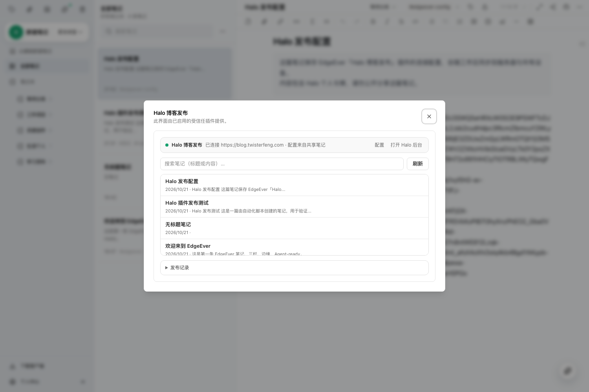

# EdgeEver Halo Publisher

把 [EdgeEver](https://github.com/tianma-if/edgever) 笔记一键发布 / 更新到 [Halo 2](https://halo.run) 博客的客户端插件。

An EdgeEver client plugin that publishes / updates your EdgeEver notes on a Halo 2 blog.



## 功能

- **一键发布 / 更新**：面板里选择笔记 → 直接发布或保存为草稿。已发布过的笔记会更新同一篇文章，不会重复建文。
- **图片自动转存**：笔记里的本地图片自动上传到 Halo 附件存储并替换为公开链接，同一张图只上传一次（按内容哈希缓存）。
- **标签 / 分类同步**：笔记标签自动创建为 Halo 标签并关联；分类可从已有分类选择或直接新建。
- **Markdown 渲染**：GFM（标题、列表、表格、代码块、引用等）→ 经 DOMPurify 清洗的 HTML。
- **跨设备共享配置**（推荐）：把 Halo 地址 + 令牌保存为一篇工作区笔记《Halo 发布配置》，
  随 EdgeEver 工作区同步到服务器，**其它设备首次使用无需重新填配置**。
- **发布映射跨设备同步**：笔记 ↔ Halo 文章映射保存在工作区笔记《Halo 发布记录》里，其它设备可直接更新同一篇文章，不会重复建文。
- **发布历史与状态**：文章链接、发布/草稿状态可查；支持「更新已发布文章 / 更新并保存草稿」。
- **连接自检**：实时显示连接状态，令牌失效时给出可读错误。
- **Web / 桌面端可用**，支持深色模式。

暂不支持：结构化笔记（图表/表格/海报/信息图）、非图片附件、Halo → EdgeEver 双向同步。

## 安装

在 EdgeEver 左侧「插件与主题」中，把下面任意一个地址填入「GitHub 仓库或 Manifest 地址」并点安装：

```
https://github.com/Fengsuid/edgever-halo-publisher
```

或直接使用 Release 里的 Manifest：

```
https://github.com/Fengsuid/edgever-halo-publisher/releases/latest/download/manifest.json
```

安装后打开插件开关（社区插件需确认「开启社区插件」）。

要求：EdgeEver v2.1.0+（插件 API v2）、Halo 2.x。

## 配置

在 Halo 后台「个人中心 → 个人令牌」生成一个 PAT（角色选超级管理员），然后：

1. 工具栏插件图标 →「Halo 博客发布」打开面板，点右上角「配置」。
2. 填写：
   - `Halo 站点地址`：例如 `https://blog.example.com`
   - `个人令牌 PAT`
3. 点「保存并同步到所有设备」（默认）：
   - 插件会在工作区创建/更新笔记《Halo 发布配置》，令牌会随工作区同步到你的其它设备；
   - 其它设备打开面板会自动读取该笔记，无需再配置。
   - 也可以选「仅保存到本设备」，配置只存在当前设备。
4. 也可以在 EdgeEver「插件与主题 → Halo 博客发布 → 设置」中填写（仅本设备生效，优先级高于共享笔记）。

> ⚠️ 共享配置笔记包含 Halo 令牌，会同步到你的 EdgeEver 服务器与所有设备。请勿公开分享这篇笔记；
> 令牌可随时在 Halo 后台撤销重建。

## 使用

1. 工具栏插件图标 →「Halo 博客发布」。
2. 搜索并选择一篇文本笔记，按需修改标题、slug、分类、标签、状态、是否上传图片。
3. 点「发布到 Halo」或「保存为草稿」，面板会显示每一步日志和文章链接。
4. 再次发布同一篇笔记时按钮会变成「更新已发布文章」。

## 开发

```bash
bun install
bun run build     # 产物：dist/{manifest.json,main.js,styles.css}，并同步到仓库根目录
```

源码结构：

```text
src/main.js      # 插件入口：Halo 客户端、Markdown 渲染、发布流程、面板 UI
src/styles.css   # 面板样式（基于宿主 CSS 变量，自动适配深色模式）
manifest.json    # 插件清单（设置项、权限声明）
e2e/             # Playwright 端到端验证脚本
```

端到端验证（需要一台运行中的 EdgeEver、一篇测试笔记、以及 Halo PAT）：

```bash
EE_BASE=http://127.0.0.1:8787 EE_USER=admin EE_PASS=... \
HALO_URL=https://blog.example.com HALO_PAT_FILE=/path/to/pat \
node e2e/publish.e2e.mjs
```

脚本会：安装插件 → 启用 → 写入共享配置笔记 → 发布带图片和标签的笔记 → 校验博客页面 →
改名验证更新 → 草稿往返 → 截图 → 清理测试内容。

## 发布新版本

1. 更新 `manifest.json` 与 `package.json` 的版本号。
2. `bun run build`，把 `dist/` 提交/推送。
3. 用与版本号一致的 tag 创建 Release（`v1.1.0` 或 `1.1.0`），并把
   `dist/manifest.json`、`dist/main.js`、`dist/styles.css` 作为 Release 资产上传。

EdgeEver 会按仓库根目录的 `manifest.json` 找到版本，再下载同名 Release 资产。

## 依赖的 Halo 接口

| 用途 | 接口 |
| --- | --- |
| 连通性 / 文章列表 | `GET /apis/api.console.halo.run/v1alpha1/posts` |
| 分类列表 | `GET /apis/content.halo.run/v1alpha1/categories` |
| 标签列表 | `GET /apis/api.console.halo.run/v1alpha1/tags` |
| 创建标签 / 分类 | `POST /apis/content.halo.run/v1alpha1/{tags,categories}` |
| 创建草稿 | `POST /apis/api.console.halo.run/v1alpha1/posts` |
| 更新文章 | `PUT /apis/api.console.halo.run/v1alpha1/posts/{name}` |
| 发布 / 撤回 | `PUT /apis/api.console.halo.run/v1alpha1/posts/{name}/{publish,unpublish}` |
| 上传图片 | `POST /apis/console.api.storage.halo.run/v1alpha1/attachments/-/upload` |

认证方式：`Authorization: Bearer <PAT>`。

## License

[MIT](LICENSE)
